<div align="center">


# KambingTV

### High-Performance, Modern IPTV & Live TV Streaming App for Android & Google TV

[](https://flutter.dev)
[](https://dart.dev)
[](https://developer.android.com)
[](file:///test)
[](LICENSE)

**KambingTV** is a feature-rich, high-performance IPTV streaming client designed with modern Material 3 aesthetics, resilient playback for unstable connections, multi-protocol screencasting, and a 60-country TV guide.

[Features](#-key-features) • [Screenshots](#-feature-showcase) • [Architecture](#-architecture) • [Getting Started](#-getting-started) • [Changelog](CHANGELOG.md)

</div>

---

## 🌟 Key Features

### 📡 6,600+ Live Verified Channels
* Curated global playlist covering **180+ countries** and major broadcast genres (News, Sports, Movies, Animation, Kids, Music, Documentary, Religious).
* Chunk-probed streams with automatic dead-link filtering and DRM badge indicators.

### 📺 Multi-Protocol Screencasting (`dart_cast`)
* Cast live streams to **Google TV**, **Chromecast**, **Smart TVs (DLNA/UPnP)**, and **AirPlay** receivers.
* **Built-in Local Proxy**: Injects necessary HTTP headers (`User-Agent`, `Referer`, auth cookies) before passing manifests to Google Cast, bypassing Chromecast's HTTP 403 receiver limitations.
* Automatic local player pause to prevent double-audio and save mobile battery.

### ⚡ Slow Connection & Data Saver Optimization
* **1-Tap Data Saver**: Caps video bitrate to **800 kbps** via native ExoPlayer track selection parameters, guaranteeing smooth 360p/480p streaming on spotty mobile data or slow Wi-Fi.
* **Infinite Resilient Auto-Retry**: Automatically recovers from packet drops and cell tower handoffs using exponential backoff instead of terminating the stream.
* **Smart Recovery Overlay**: Suggests 1-tap remedies (Data Saver, Audio-Only, Retry) whenever network stalling is detected.

### 📅 Multi-Country XMLTV EPG (TV Guide)
* Concurrent schedule downloader covering **60+ countries** with transparent GZIP decompression (`.xml.gz`).
* Real-time NOW and NEXT schedule timeline with fuzzy name and resolution tag matching (`@HD`/`@SD`).

### 🎧 Audio-Only & Screen-Off Playback
* Dedicated **Audio-Only mode** that disables video rendering and streams only AAC audio (~64–96 kbps), ideal for talk radio, news, and low-signal environments.
* Integrated with native Android `MediaPlaybackService` (Foreground Service) for continuous playback with the screen turned off or while multitasking.

### 🎨 Adaptive Channel Placeholders
* Deterministic 8-palette gradient cards based on channel name hashes for feeds without logos.
* Embedded ISO country flag badges and bold typography.
* Runtime sanitizer filtering out deleted Imgur images (`removed.png`).

### 🔍 Organized Category Navigation
* Modal sheet with live search and three filtered views: **Genres (10)**, **Countries (169)**, and **Raw Groups (208)** with real-time channel counts.

---

## 📸 Feature Showcase

| 01. Live TV Catalog | 02. Live Channel Search | 03. Genre Filtering |
| :---: | :---: | :---: |
| 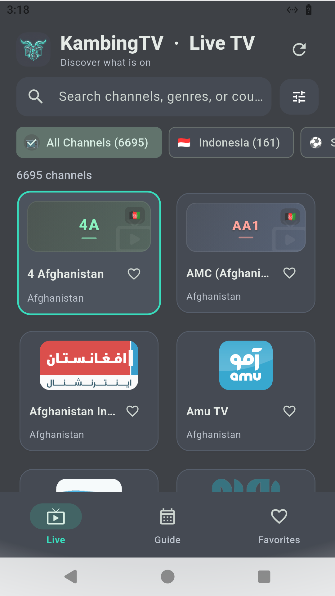 | 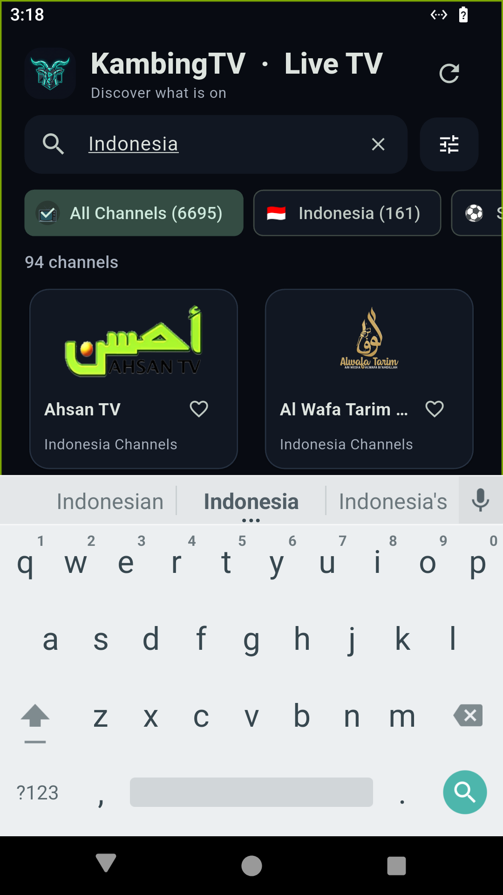 | 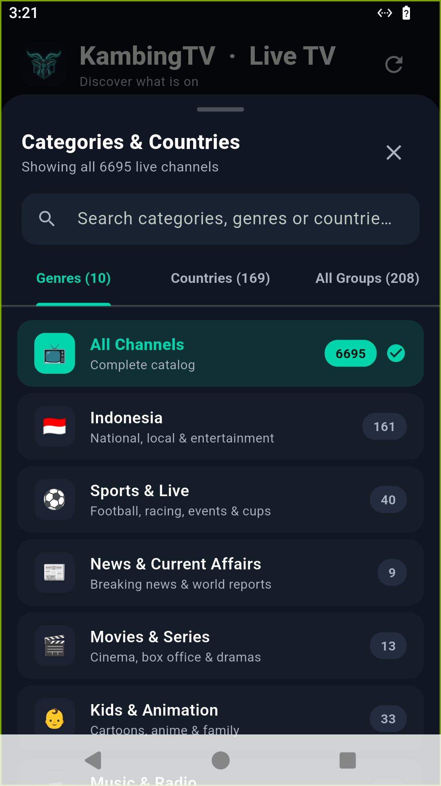 |
| *6,600+ channels with quick filter chips* | *Instant real-time channel search* | *Unified genres with channel counts* |

| 04. Country Directory | 05. TV Guide (XMLTV EPG) | 06. Favorites |
| :---: | :---: | :---: |
| 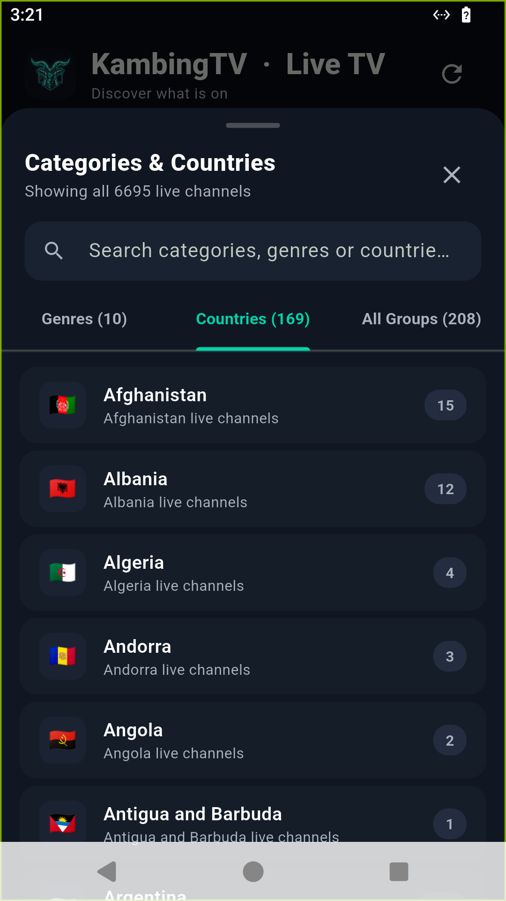 | 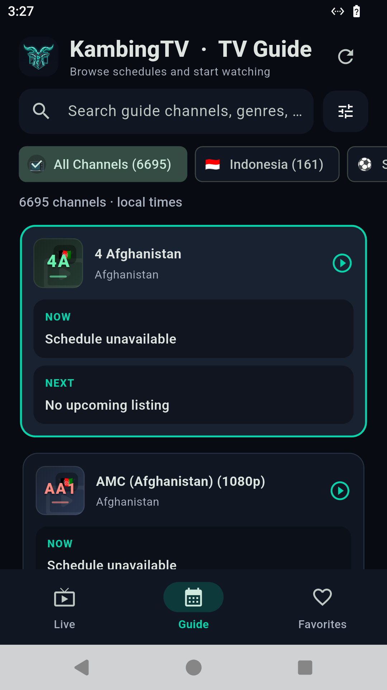 | 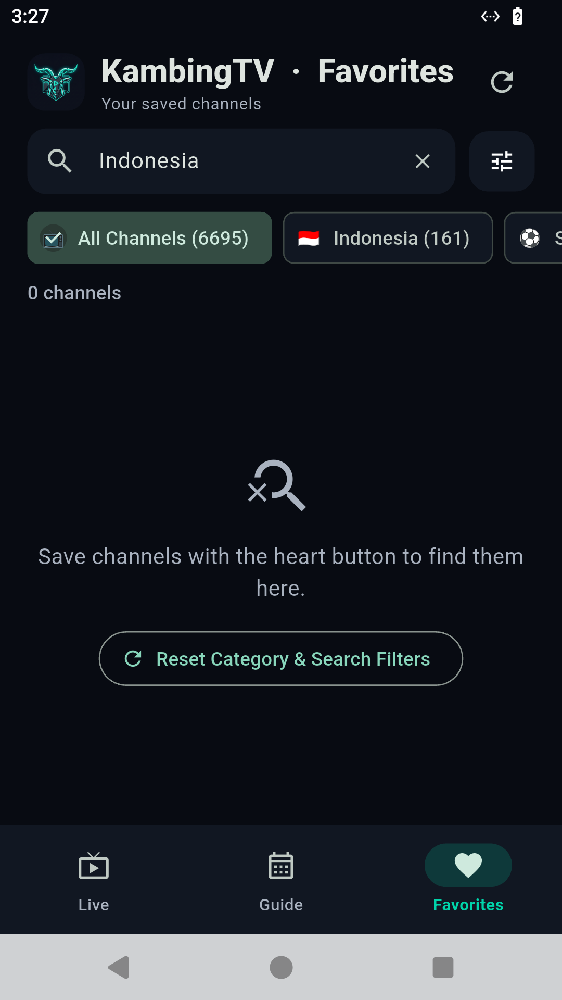 |
| *169 countries with ISO flag badges* | *NOW & NEXT program timeline* | *Saved channels collection* |

| 07. Live Video Player | 08. Slow Connection Mode | 09. Audio-Only Mode |
| :---: | :---: | :---: |
| 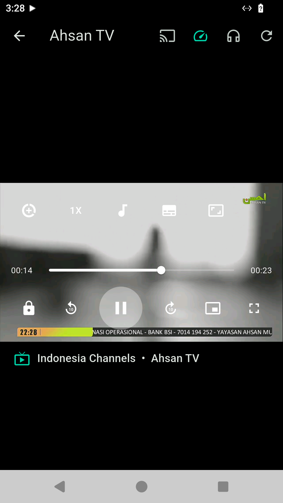 | 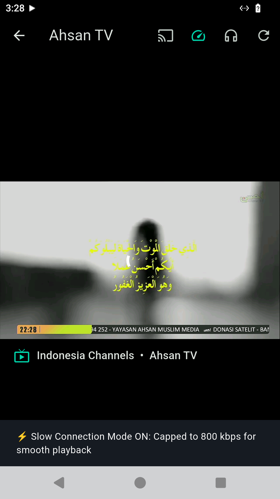 | 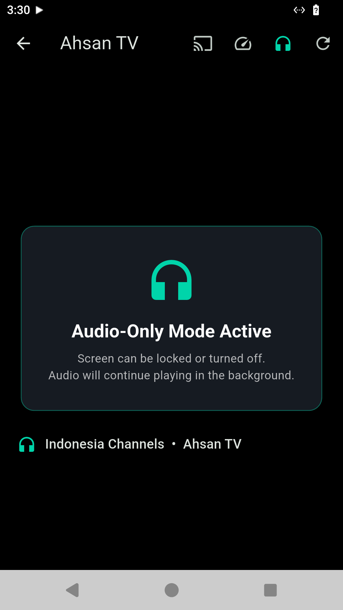 |
| *1080p HLS playback with gesture controls* | *800 kbps Data Saver cap enabled* | *Screen-off background audio card* |

| 10. Multi-Protocol Screencast | 11. Stalled Stream Recovery |
| :---: | :---: |
| 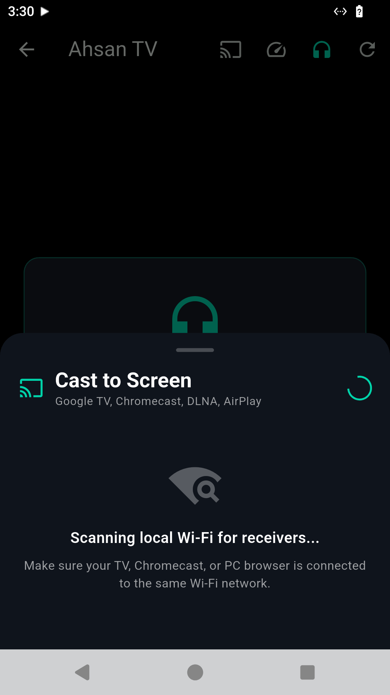 | 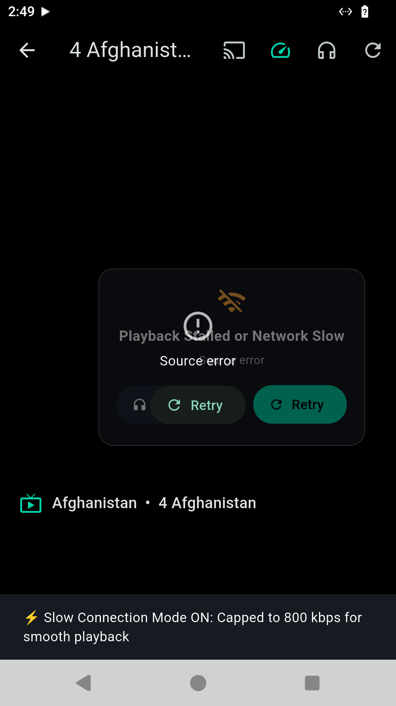 |
| *Wi-Fi radar discovery (Chromecast/DLNA/AirPlay)* | *1-tap remedies for spotty connections* |

---

## 🏗 Architecture

```
lib/
├── main.dart                          # App initialization, dark theme, navigation
├── models/
│   ├── channel.dart                   # Channel entity, DRM config, logo sanitizer
│   └── epg_programme.dart             # XMLTV schedule entity
├── services/
│   ├── background_playback_service.dart # Native Android Foreground Service bridge
│   ├── cast_manager.dart              # Multi-protocol screencast coordinator (dart_cast)
│   ├── category_service.dart          # 200+ raw group aggregator into Genres & Countries
│   ├── epg_service.dart               # 60-country GZIP XMLTV downloader & parser
│   ├── playback_settings_service.dart # Resilient buffering & Data Saver preferences
│   └── playlist_service.dart          # M3U playlist loader & dead-chunk cache
├── screens/
│   ├── home_screen.dart               # Main channel catalog & quick filters
│   ├── guide_screen.dart              # Interactive EPG schedule timeline
│   └── player_screen.dart             # Video player, cast button, speed toggle, audio mode
└── widgets/
    ├── cast_device_sheet.dart         # Wi-Fi receiver discovery bottom sheet
    ├── category_selector_sheet.dart   # Searchable category modal sheet
    └── channel_avatar.dart            # Deterministic gradient card placeholders & flag badges
```

---

## 🚀 Getting Started

### Prerequisites
* [Flutter SDK](https://docs.flutter.dev/get-started/install) (>= 3.47.0)
* Dart SDK (>= 3.13.5)
* Android SDK (API 34 / Android 14+ recommended)

### Installation & Run

1. **Clone repository**:
   ```bash
   git clone https://github.com/your-repo/opentv.git
   cd opentv
   ```

2. **Install dependencies**:
   ```bash
   flutter pub get
   ```

3. **Run on connected device or emulator**:
   ```bash
   flutter run
   ```

4. **Build Production Release APK**:
   ```bash
   flutter build apk --release
   ```
   The optimized release APK will be located at:
   `build/app/outputs/flutter-apk/app-release.apk`

---

## 🧪 Testing & Quality Assurance

All suites pass with 0 issues:

```bash
# Run unit & widget test suites
flutter test

# Run static code analysis
flutter analyze
```

* **Test Suites**:
  * [`test/cast_manager_test.dart`](test/cast_manager_test.dart): Media type detection, session state transitions.
  * [`test/cast_device_sheet_test.dart`](test/cast_device_sheet_test.dart): Discovery sheet widget rendering & lifecycle.
  * [`test/playback_settings_service_test.dart`](test/playback_settings_service_test.dart): Resilient buffering options & Data Saver preferences.
  * [`test/category_service_test.dart`](test/category_service_test.dart): Genre grouping, country flag emoji mapping, and channel counters.
  * [`test/channel_avatar_test.dart`](test/channel_avatar_test.dart): Logo sanitization, dead Imgur detection, gradient selection.
  * [`test/epg_service_test.dart`](test/epg_service_test.dart): Transparent GZIP decompression & XMLTV schedule parsing.
  * [`test/widget_test.dart`](test/widget_test.dart): End-to-end app bootstrapping.

---

## 📄 License

This project is licensed under the MIT License - see the [LICENSE](LICENSE) file for details.
